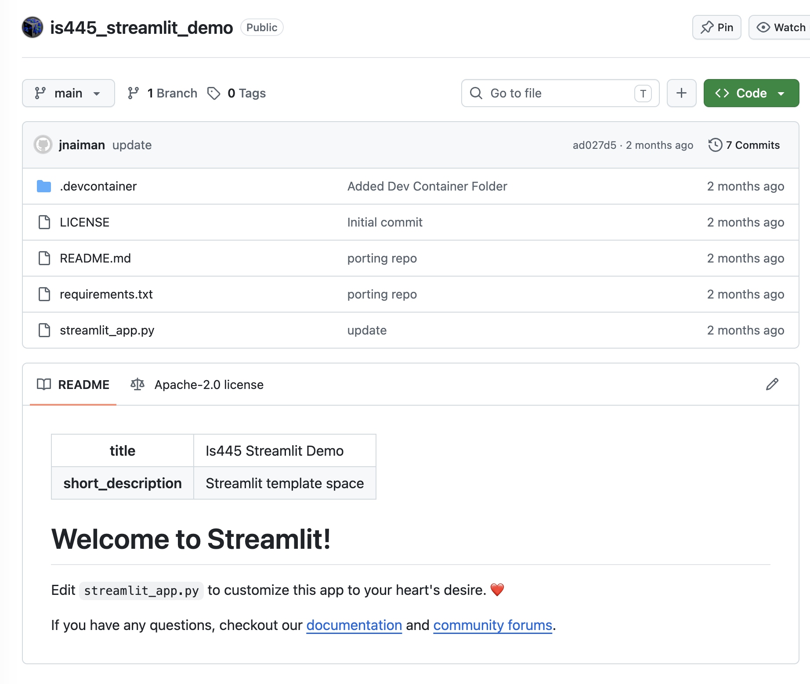
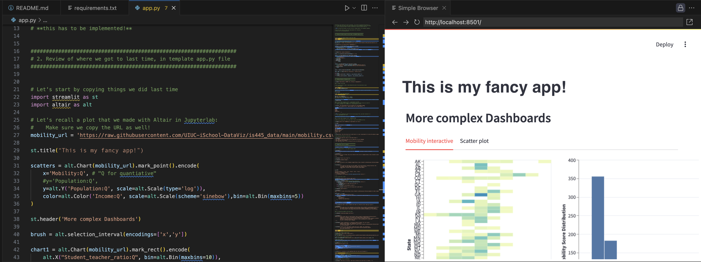

## Sharing Streamlit Apps

Today we will work on sharing our Streamlit apps with the public using Streamlit.io.

(and continue adding some features)

notes:
so far we've been building streamlit apps locally (or on PL) but we don't have a way to share this with our adoring public :D

we'll talk more about this today

---

## The template



notes:
lets look at the template we installed in Lab 8

we'll look at a few important files


---

## The `streamlit_app.py` file



notes:
so far we've really been looking at one file -- the app.py file

this is where we right the majority of our code that makes plots and interactive elements for us

but there are other files that we need to be concerned with when building an app

---

## The `requirements.txt` file

```yaml
streamlit
altair
```

notes:
we also have to include one more file -- the requirements.txt file

this contains all of the packages that need to be installed for our app to work

Streamlit.io needs to know about these packages so it knows what it needs to install before running your app

---

## Streamlit.io Development Strategies

For new apps, the easiest way to build is to start by a "similar enough" app and duplicate it.

---

## Streamlit.io Development Strategies

For new apps, the easiest way to build is to start by a "similar enough" app and duplicate it.

Good news! You already did this in Lab 8!

---

## Streamlit.io Development Strategies

For new apps, the easiest way to build is to start by a "similar enough" app and duplicate it.

Good news! You already did this in Lab 8!

You can also search [Streamlit.io's gallery](https://streamlit.io/gallery) for others.

Examples you can fork:
 * [GoodReads](https://goodreads.streamlit.app/?ref=streamlit-io-gallery-data-visualization)
 * [Data Science at Swast](https://data-science-at-swast-handover-poc-handover-yfa2kz.streamlit.app/)

